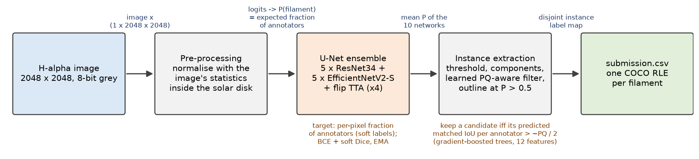

# Solar filament instance segmentation (IEEE BigData Cup 2026)

Code for the *Solar Filament Segmentation Challenge 2026*
(Kaggle community competition `filament-segmentation-2026`; data: MAGFiLO,
GONG H-alpha full-disk observations, 2048 x 2048 px).

The task is to output one mask per filament. Submissions are ranked by
Panoptic Quality (PQ: a predicted and a ground-truth filament match when their
IoU exceeds 0.5), computed against every annotator's set of polygons separately.



## Approach

1. **Label analysis.** Two experts annotating the same image agree at PQ 0.34,
   and the union / intersection of two annotators predicts a third no better
   (0.33 / 0.31). Annotator style dominates the metric
   (`scripts/annotator_agreement.py`, `docs/annotator_agreement.json`).
2. **Soft consensus target.** Up to three annotators labelled each image; the
   network learns the per-pixel fraction of annotators that mark a pixel.
3. **Segmentation network.** U-Net (segmentation-models-pytorch) on the single
   grey channel at the native 2048 px resolution: trained on 768 px crops
   (mostly centred on filaments) with flips, arbitrary rotations, scaling and
   photometric jitter; each image is normalised with its own statistics inside
   the solar disk; BCE + soft Dice; AdamW with warm-up and cosine decay; EMA of
   the weights. ResNet34 and EfficientNetV2-S encoders, 5-fold cross-validation.
4. **Instances = connected components.** Annotated filaments practically never
   touch (8,199 polygons form 8,219 connected components), so instances are
   the connected components of the thresholded (ensemble-averaged, flip-TTA)
   probability map, with hole filling.
5. **PQ-aware selection.** For disjoint instances PQ decomposes over
   components: keeping a candidate improves PQ iff its expected matched IoU per
   annotator exceeds PQ / 2 (`filseg/components.py`). The detection shape
   (threshold, closing, outline level) is chosen by nested cross-validation on
   out-of-fold predictions (`scripts/select_post.py`), and a small learned
   filter (gradient-boosted trees on per-component features, exported to JSON so
   inference needs only numpy; `filseg/scorer.py`, `scripts/fit_scorer.py`)
   decides which candidates to keep. Kept instances are redrawn where the
   probability exceeds 0.5.

Experiments and numbers: `docs/experiments.md`. Report: `docs/report/main.tex` (draft in
`docs/report_draft.md`). Figures: `docs/figures/` (pipeline, out-of-fold evaluation, morphology examples).

## Reproducing the submission

`notebooks/pipeline.ipynb` (committed with the outputs of a run on a Kaggle T4 GPU) runs the whole
inference pipeline from the weights
in `weights/` (no training needed): it predicts every test image, writes
`submission.csv`, shows predictions and, if the training annotations are
available, recomputes the hold-out PQ, IoU / Dice distributions and
one-to-many / many-to-one statistics.

```bash
git clone --depth 1 <repository URL>   # ~0.5 GB, mostly the ten weight files (43-47 MB each)
pip install -r requirements.txt
jupyter nbconvert --to notebook --execute notebooks/pipeline.ipynb   # or open and Run All
```

Two profiles (variable `PROFILE` in the notebook, or `FILSEG_PROFILE`), measured
end to end on one T4 GPU for the 180 test images (`scripts/run_notebook.py`):

| profile | networks | out-of-fold PQ (nested CV)* | time per image |
|---|---|---|---|
| `full` (submission) | 5 x ResNet34 + 5 x EfficientNetV2-S U-Nets | 0.447 | 8.0-8.5 s |
| `fast` | 5 x EfficientNetV2-S U-Nets | 0.444 | 5.2-5.3 s |

\* Both encoders use the same five folds, so a training image's out-of-fold map averages only the
networks that did not see it (two for `full`, one for `fast`); the submission averages all of them.

## Training from scratch

```bash
# one fold (fold k is held out); writes model.pt, val_probs.npz, test_probs.npz, logs
python -m filseg.train --data MAGFiLO_1.0_Kaggle_2026 --out runs/r34_f0 --fold 0 \
    --res 2048 --crop 768 --epoch-mult 4 --norm disk --encoder resnet34 --bs 8 --epochs 30 \
    --lr 3e-4 --ema 0.999 --tta 4 --predict-test --post configs/post_c1_nested.json
# several folds in sequence
python -m filseg.cv --folds 1 2 3 4 --out runs/r34 -- --data MAGFiLO_1.0_Kaggle_2026 --res 2048 ...
# choose the detection shape by nested CV on all out-of-fold maps (also reports the learned filter)
python scripts/select_post.py --probs runs/*/fold*/val_probs.npz --data MAGFiLO_1.0_Kaggle_2026 --out runs/sel \
    --thresholds 0.25 0.3 0.35 0.4 0.45 --close 0 4 --mask 0 0.5 --r 1.0 0.77 --learned
# fit the learned component filter on the selected shape (writes a self-contained post-processing JSON)
python scripts/fit_scorer.py --components runs/sel/components_t0.25_c0_o0.5.pkl --r 0.77 \
    --out runs/sel/post_learned_r0.77.json
# ensemble submission from the saved test maps
python scripts/ensemble_submit.py --probs runs/*/fold*/test_probs.npz --post runs/sel/post_learned_r0.77.json \
    --test-dir MAGFiLO_1.0_Kaggle_2026/test/test_images --out submission.csv
# collect the weights for the notebook (optional faster profile with its own filter)
python scripts/make_weights.py --runs runs/*/fold* --post runs/sel/post_learned_r0.77.json \
    --fast-post runs/sel_v2s/post_learned_r0.77.json --out weights
# check that the notebook reproduces the submission from the weights (fresh copy of the repository)
python scripts/run_notebook.py --profile full --weights weights/manifest.json --out runs/nb_full
```

## Repository layout

| path | content |
|------|---------|
| `filseg/data.py` | COCO annotation parsing, polygon rasterisation, soft targets, folds |
| `filseg/rle.py`, `filseg/submission.py` | COCO RLE and validated submission writing |
| `filseg/metrics.py` | Panoptic Quality identical to the organisers' self-evaluation notebook |
| `filseg/augment.py` | crop-first geometric and photometric augmentation |
| `filseg/model.py` | network, normalisation, fp16 checkpoints, flip / rotation TTA prediction |
| `filseg/train.py`, `filseg/cv.py` | training (EMA, OOM fallback, time budget), CV driver |
| `filseg/postprocess.py`, `filseg/tune.py` | probability map -> instances; post-processing scoring |
| `filseg/components.py` | per-component PQ decomposition, nested rule selection, nested CV of the learned filter |
| `filseg/scorer.py` | learned component filter: gradient-boosted trees exported to JSON, numpy inference |
| `filseg/analysis.py` | error analysis (by size, aggregation, matching degrees, error causes with PQ upper bounds) |
| `filseg/infer.py` | inference / ensembling from saved weights |
| `filseg/classical.py` | traditional (non-learning) darkness-threshold baseline |
| `scripts/` | label agreement, OOF analysis, rule selection, model comparison, ensembling, figures, checks; optional semi-supervised tools (`fetch_gong.py` unlabelled archive images, `pseudo_label.py` teacher maps, `chain.py`) |
| `configs/` | post-processing configurations (`post_final_full.json` / `post_final_fast.json` = submission) |
| `notebooks/` | `pipeline.ipynb` (executed) and its generator |
| `weights/` | the ten fp16 networks (one per encoder and fold) and `manifest.json` (files, SHA-256, training arguments, post-processing of both profiles) |
| `docs/` | experiment log, report, figures, evaluation numbers, list of the external images |
| `kaggle/` | builders for self-contained Kaggle kernels and Colab notebooks |
| `tests/` | unit tests (`python -m pytest tests`) |

## Data and licence

The MAGFiLO images and annotations are provided by the competition organisers
(GONG data courtesy of NSO/AURA/NSF) and are **not** redistributed here.
Training uses only the competition's training annotations; inference uses only
the test H-alpha images. The semi-supervised experiment (tested, **not used** by the final models; see
`docs/experiments.md`) additionally used *unlabelled* GONG H-alpha images from the public NSO archive, taken on days at least
two days away from every competition image (`scripts/fetch_gong.py`; images are fetched,
not redistributed). `docs/external_gong_manifest.csv` lists every image (URL, date, SHA-256 of the
original and of the processed file); `scripts/check_external.py` re-checks the date gap against all
train and test images and that the processing reproduces each file byte for byte. Code is released under the MIT licence.
